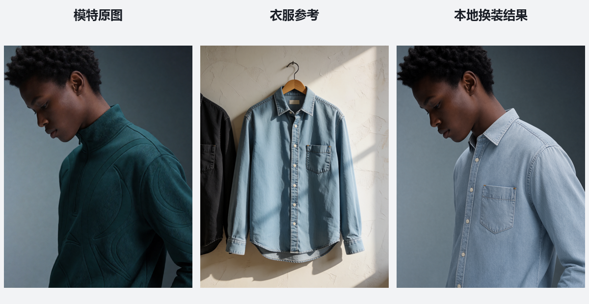
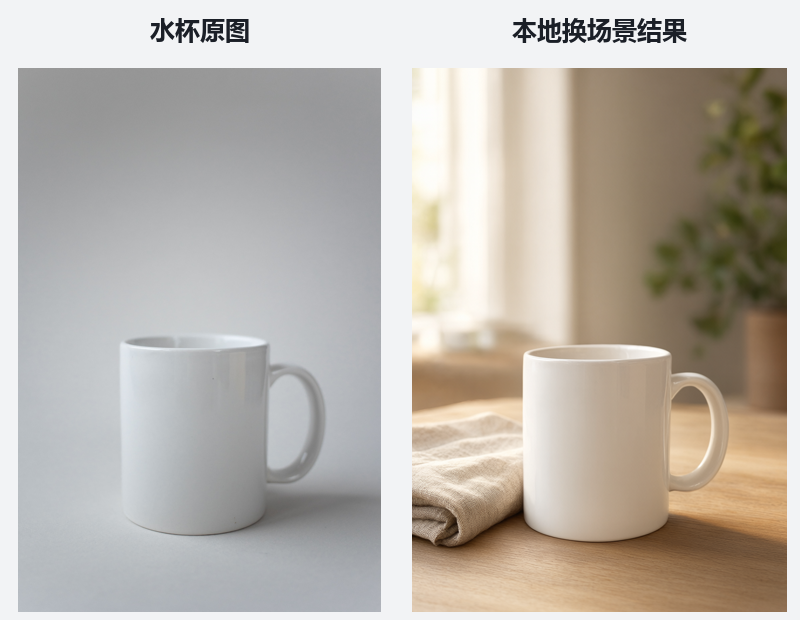

# 本地 AI 实跑档案 / Local AI Run Archive

记录这台电脑实际完成的图像编辑、视频生成、角色配音实验。最后整理：2026-10-22（Asia/Shanghai）。

## 已跑通

| 实验 | 本地模型 | 结果 | 记录 |
|---|---|---|---|
| 模特换装 | Qwen Image 2.1 INT8 | 672×864，约26.7秒 | [对比图](experiments/qwen-image21/模特换装-前后对比.png) · [工作流](experiments/qwen-image21/模特换装-拖入ComfyUI.json) |
| 水杯换场景 | Qwen Image 2.1 INT8 | 640×960，约17.7秒 | [对比图](experiments/qwen-image21/水杯-前后对比.png) · [工作流](experiments/qwen-image21/水杯换场景-拖入ComfyUI.json) |
| 教室阳光、微风窗帘 | MiniMax H3 | 416×736，约10.83秒视频 | [成片](experiments/minimax-h3/classroom.mp4) |
| 噜噜点 Yes 职场短片 | MiniMax H3 | 416×736，约15.08秒 | [成片](experiments/minimax-h3/lulu-yes-original-audio.mp4) |
| 噜噜和噜妹声线试配 | HDemucs + Qwen3-TTS 1.7B Base | 六句对白替换、保留原版 | [第二版成片](experiments/voice-clone/lulu-yes-voice-v2.mp4) |
| 动漫手势舞、情侣动画 | MiniMax H3 | 已生成可播放视频 | [视频目录](experiments/minimax-h3) |

## 给后续 AI 的入口

先读 [AGENTS.md](AGENTS.md)，再读 [CATALOG.json](CATALOG.json) 与 [docs/ENVIRONMENT.md](docs/ENVIRONMENT.md)。可从工作流和运行结果继续，不必重新安装已有模型。

## 记录的含义

运行状态、工作流、输出文件及 SHA-256 清单共同用于核对本地实验。该仓库是事后整理的实验档案，不是第三方认证或可信时间戳证明。文件时间、结果和限制按实际记录保留。模型权重和运行时未纳入 Git。

## 使用限制与来源

换装属于图像编辑近似效果，不表示真实尺码适配。声线参考仅约3—4秒，第二版仍可能有合成痕迹，未重做口型。水豚角色及第三方参考素材不因此获得新授权，参见各实验说明。示例水杯照片来源 Pexels / KATRIN BOLOVTSOVA，模特与衣服来源 Comfy-Org 官方工作流示例。
