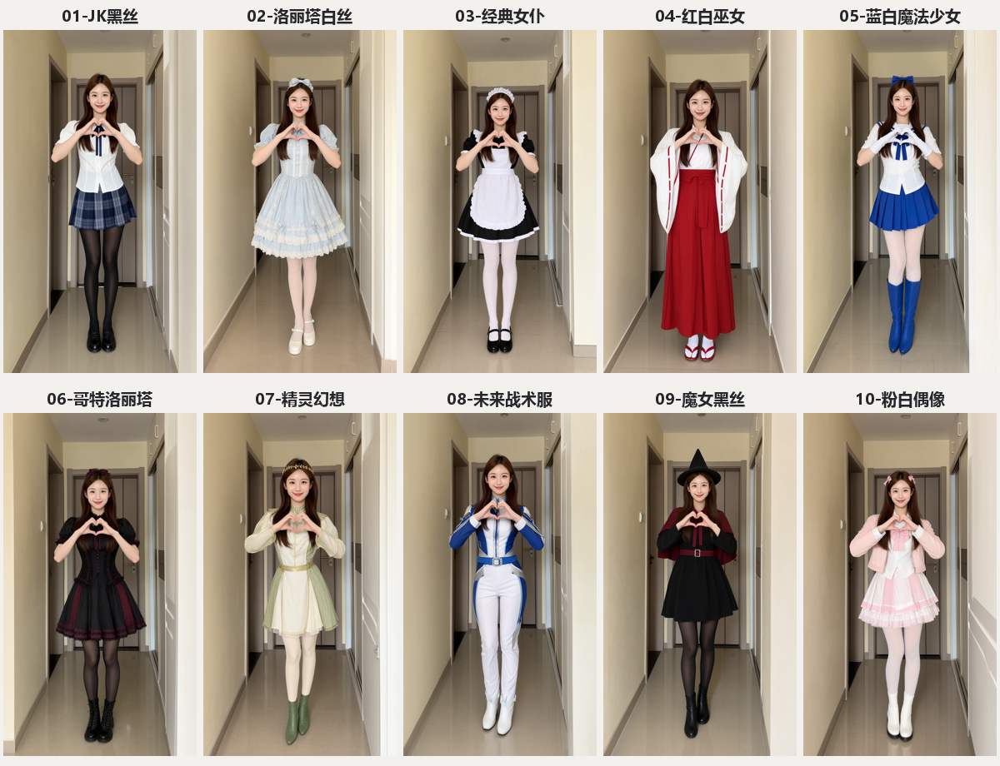

# 本地生成式 AI 工作流与作品集

**ComfyUI · Qwen Image 2.1 · MiniMax H3 · Qwen3-TTS · Python · GitHub MCP**

在 RTX 5060 Ti（16GB 显存）与 16GB 内存的 Windows 设备上，完成从模型部署、参考图编辑、批量视频生成到配音后期与成果归档的端到端实践。

## 在线体验

### [打开作品展示页：鼠标滑动查看换装前后 →](https://qiu-q.github.io/local-ai-run-archive/)

在展示页图片上左右移动鼠标，或用手指拖动分界线：**左侧显示原图，右侧显示编辑结果**。键盘方向键也可调整。GitHub README 使用静态预览，交互效果在展示页中运行。

## 项目介绍

本项目将开源生成式 AI 模型转化为可执行、可查看结果、可延续使用的本地工作流，覆盖服装参考图换装、产品摄影场景编辑、角色视频和配音试配。保留输入来源、提示词、工作流、输出与运行记录，支持后续复用和结果核对。

### 主要完成内容

- **本地部署与资源适配**：配置 ComfyUI 与量化模型，完成图像编辑、短视频生成及少样本语音合成。
- **多图参考编辑**：以人物图和衣服图为条件完成模特换装；以产品图和文字指令完成水杯场景替换。
- **批量任务编排**：使用 Python 与 ComfyUI API 管理输入、提示词、采样参数和任务结果，生成十套服装变体及动态片段。
- **媒体后期处理**：完成片段剪辑、转场、字幕、音轨替换和解码检查，输出 30 秒换装合集。
- **成果与协作入口**：以 Git 管理版本、运行状态和 SHA-256 清单，配置 GitHub CLI/MCP 与 AI 项目说明。
- **交互展示**：开发适配桌面和触屏的前后图像滑动对比页面，部署到 GitHub Pages。

## Qwen Image 2.1 在本项目中的作用

Qwen Image 2.1 用于根据文字要求编辑已有图片，并支持多张参考图。本项目采用官方 ComfyUI 兼容的 INT8 ConvRot 权重，配合图像理解编码器与 VAE 完成本地推理。

**换装流程**：人物图 + 衣服参考图 → 编辑指令 → 图像编码与采样 → 换装结果。尽量保持脸、姿势和背景，并迁移衣服的颜色、领型、纽扣、口袋及材质。

**产品图流程**：水杯原图 + 场景描述 → 在保留主体造型的基础上生成木桌、窗边光线与环境。

滑动分界线属于前后结果展示控件。若要只修改衣服的某一块区域，需要另外采用遮罩/局部重绘工作流；本次记录的换装使用完整图片的指令编辑。

## 已完成的实跑结果

| 实验 | 模型 / 方法 | 实际输出 | 产物与记录 |
|---|---|---|---|
| 模特换装 | Qwen Image 2.1 INT8，多图参考 | 672×864；25步；约26.7秒 | [工作流](experiments/qwen-image21/模特换装-拖入ComfyUI.json) · [运行记录](experiments/qwen-image21/run-results.json) |
| 水杯换场景 | Qwen Image 2.1 INT8，单图编辑 | 640×960；25步；约17.7秒 | [结果](experiments/qwen-image21/水杯换场景结果.png) · [工作流](experiments/qwen-image21/水杯换场景-拖入ComfyUI.json) |
| 十套换装舞蹈 | Qwen Image 2.1 + MiniMax H3 | 10套；30秒；720帧；352×608 | [成片](experiments/ten-outfit-dance/ten-outfit-dance-30s.mp4) · [任务记录](experiments/ten-outfit-dance/video-run-results.json) |
| 教室阳光与微风窗帘 | MiniMax H3 | 416×736；约10.83秒 | [成片](experiments/minimax-h3/classroom.mp4) · [工作流](experiments/minimax-h3/classroom-workflow.json) |
| 噜噜点Yes职场短片 | MiniMax H3 + 弹窗/字幕后期 | 416×736；约15.08秒 | [成片](experiments/minimax-h3/lulu-yes-original-audio.mp4) |
| 双角色声线试配 | HDemucs + Qwen3-TTS 1.7B Base | 人声分离、6句对白替换 | [第二版](experiments/voice-clone/lulu-yes-voice-v2.mp4) · [检查记录](experiments/voice-clone/verification-v2.json) |

图像生成耗时为本机单次工作流执行记录，不含首次权重下载时间，不代表统一性能基准。

## 可用于简历的项目摘要

**本地生成式 AI 多模态工作流与成果展示**  
技术栈：ComfyUI、Qwen Image 2.1、MiniMax H3、Qwen3-TTS、Python、PyAV、Git/GitHub、MCP。

- 在16GB显存设备部署并串联图像编辑、短视频生成和语音后期流程，完成可查看结果的本地应用验证。
- 构建多图参考换装与单图产品场景编辑工作流，记录分辨率、采样参数、任务状态和实际输出。
- 编排十套服装变体与十段视频任务，合成30秒动态换装作品，完成字幕、转场和媒体完整性检查。
- 建立包含提示词、工作流、样例和文件校验清单的公开成果仓库，并提供交互式图像对比展示页。

## 复用与项目入口

1. 查看 [环境说明](docs/ENVIRONMENT.md) 和实验目录中的使用说明。
2. 将相关 JSON 工作流导入 ComfyUI，上传输入图像并修改编辑指令。
3. 模型权重按官方来源另行下载，本仓库不包含大型模型与运行时。
4. 后续 AI 先读 [AGENTS.md](AGENTS.md) 和 [CATALOG.json](CATALOG.json)，再按已完成记录继续工作。

## 来源与限制

- 基础模型来自公开项目，本仓库记录模型部署、应用编排与结果展示，不主张原创训练这些基础模型。
- 换装是视觉近似编辑，不提供真实尺码或布料物理仿真；人物和商品细节仍需人工检查。
- 十套舞蹈的动作重新生成，局部脸、手与服装可能漂移；配音参考仅约3—4秒，未重新生成口型。
- 文件清单和运行日志用于核对实验产物，是事后整理的记录，不是第三方认证。
- 模特与服装示例：[Comfy-Org 官方模板](https://github.com/Comfy-Org/workflow_templates/blob/main/templates/image_qwen_image_2_1_image_edit.json)。水杯照片：[KATRIN BOLOVTSOVA / Pexels](https://www.pexels.com/photo/white-ceramic-mug-on-white-table-6312237/)。水豚及第三方素材的权利归原权利人，成果归档不产生额外授权。

最后更新：**2026-10-23 · Asia/Shanghai**。

## H3 专题项目

[H3 Video Lab：首尾帧、时长参数、动作参考与实跑证据](https://github.com/qiu-q/h3-video-lab)。其中动作迁移方案尚未实跑，已有十套舞蹈为提示词重新生成。
